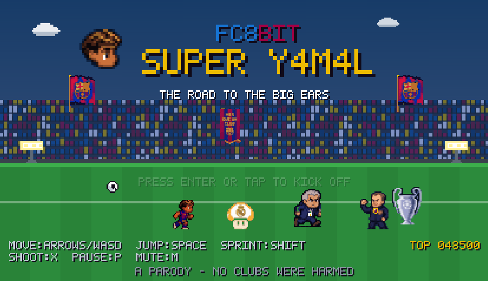
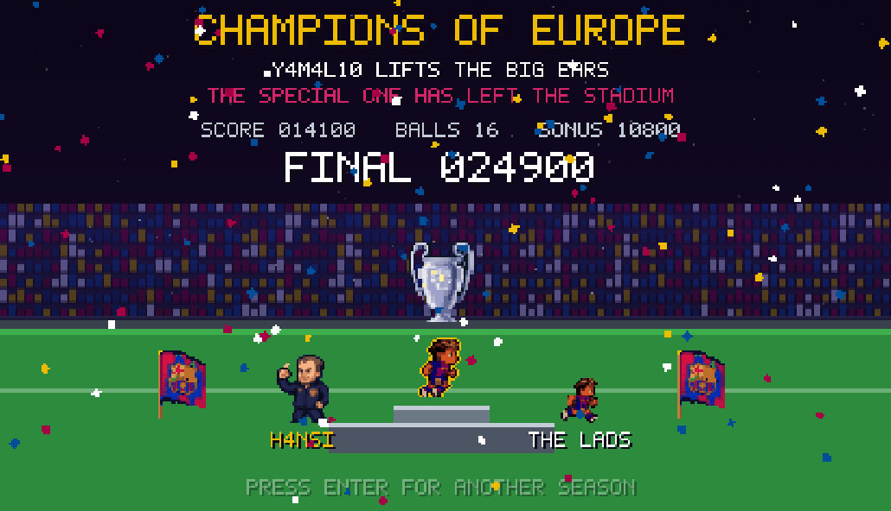

# FC8Bit Super Y4M4L

An 8-bit football platformer in the Super Mario tradition. You play **Y4M4L10**, a
blaugrana-striped number 10 who collects footballs instead of coins, stomps
*Merengue mushrooms* in white kits, outruns **MB4PPE**, and climbs the Holy Tower to
beat **THE SPECIAL ONE** and lift the Champions trophy — the Big Ears — with
**H4NSI** waiting beside it.





> A fan project, built for learning and for fun. Not for profit, not affiliated
> with any club, and no football rights are owned here — please read the
> [Disclaimer](#disclaimer).

Built with **Phaser 3.90** (vendored, so it runs offline). Y4M4L10, the Merengue
mushrooms, MB4PPE, THE SPECIAL ONE, H4NSI FL1CK, the Champions cup, the senyera
flags, the *Més Que Un Club* pennant and the stadium board all come from the
supplied reference art in `assets/source/`; everything else — tiles, stadium,
crowd, items, HUD font and most audio — is generated procedurally at boot. The
one recorded asset is the 8-bit anthem in `assets/audio/`; every other sound is
synthesised. The game still runs with `assets/` deleted — it falls back to the
procedural sprites and the synth soundtrack.

## Play

```bash
npm start
```

That serves the folder on <http://localhost:5199> and opens it. Any static server
works. Opening `index.html` straight off disk also runs, but some browsers refuse
to decode local PNGs into a canvas over `file://` — if that happens the game logs
a warning and falls back to the procedural sprites, so serve it over HTTP to see
the hand-drawn art.

## Online scoreboard (optional)

A small **.NET 10** minimal API in `server/` stores scores in a local SQLite
file. The game works perfectly well without it — if the API is not running the
title board is simply absent and scores stay in `localStorage`.

```bash
npm run api      # http://localhost:5090
npm start        # the game, in another terminal
```

| Endpoint | What it does |
| --- | --- |
| `GET /api/scores?limit=10` | top scores, ranked |
| `POST /api/scores` | submit a run (signed, see below) |
| `GET /api/health` | liveness |

After a run the game asks for a name and posts `name, score, balls, level,
timestamp, nonce` plus an **HMAC-SHA256** over exactly that payload. The server
rebuilds the signature and rejects anything that does not match, so a score
cannot simply be `curl`'d in.

**Be clear about what that buys.** The key also lives in `src/scores.js`, so
anyone willing to open devtools can sign their own payload. It stops casual
fake posts, not a determined player. The protections that hold regardless are
all server-side:

- score ceiling and name/level/balls bounds (`Scores:MaxScore`)
- a timestamp window, so a captured request goes stale
- a single-use nonce, so a valid request cannot be replayed
- a per-IP rate limit on submissions

Making this genuinely tamper-proof needs the server to own the scoring — accept
a replay of the run and validate it, or simulate it — which is a much larger
piece of work than a hash. Settings live under `Scores` in
`server/appsettings.json`; change `Secret` (and the copy in `src/scores.js`)
before putting this anywhere public.

### Deploying the API to Fly.io

Only `server/` is deployed; the game itself is static and goes elsewhere.
`server/Dockerfile` and `server/fly.toml` are set up for it, and the build
context is `server/`, so nothing from the game ends up in the image.

Everything the server reads is configuration, and ASP.NET maps env vars onto
it: `Scores__Secret` becomes `Scores:Secret`, `Scores__Origins__0` the first
allowed origin.

```bash
cd server
fly launch --no-deploy            # fly.toml already names the app: superyamal

# SQLite needs somewhere that survives a deploy - a container filesystem
# does not. Must be in the same region as primary_region.
fly volumes create superyamal_scores_data --size 1 --region ams

fly secrets set Scores__Secret="$(openssl rand -hex 32)"
fly secrets set Scores__Origins__0="https://your-game-host"

fly deploy
fly scale count 1                 # see the warning below
curl https://superyamal.fly.dev/api/health
```

The game already points at `https://superyamal.fly.dev` (`API_PROD` in
`src/scores.js`); it uses the local server when the page is served from a dev
host and the deployed one otherwise, so neither needs swapping by hand.

Four things that will bite otherwise:

* **Never scale past one machine.** The volume attaches to a single machine,
  and SQLite cannot be shared across them - a second machine would quietly
  serve its own empty database to half your players.
* **CORS is a strict allow-list.** `Scores__Origins__0` must be the exact
  origin the game is served from, scheme included. Miss it and every request
  fails in the browser while `curl` works fine.
* **`Scores__ClientIpHeader` matters behind the proxy.** Fly terminates the
  connection, so without it every request looks like it came from the proxy
  and the per-IP rate limit becomes one shared 10/min bucket for the whole
  world. `fly.toml` sets it to `Fly-Client-IP`, which the proxy writes itself
  and overwrites on the way in. Do not point it at a header a caller can set.
* **It is sized for idle, not for load.** One shared vCPU, 256MB, and
  `auto_stop_machines`, so the machine stops when nothing is asking and
  compute is only billed while it serves; the volume is the standing cost.
  The API measures ~50MB at boot and ~61MB after a burst of requests, so the
  headroom is real. The trade is a cold start on the first request after an
  idle spell - which is why the client timeout in `src/scores.js` is 8s and
  not 4s. Nothing waits on that fetch, so a slow board never delays the title.

* **The secret is still only obfuscation.** It ships in `src/scores.js`
  whatever you set it to. Rotate it off the committed placeholder, but see the
  honesty note above for what it actually buys.

## Controls

| Action | Keys |
| --- | --- |
| Move | `←` `→` or `A` `D` |
| Jump (hold for height) | `Space`, `↑`, `W` |
| Sprint | `Shift` |
| Shoot a ball | `X` or `J` (needs the Golden Boot) |
| Pause | `P` or `Esc` |
| Mute | `M` |

### Touch

On a touch device a control deck appears **below** the canvas: `◀` `▶`, KICK,
JUMP, and a small RUN / PAUSE / MUTE column (the keyboard hints are hidden
there, so those would otherwise be unreachable).

RUN **latches** rather than being held: both thumbs are already on direction
and jump, so a held sprint would need a third finger. Tap it on, tap it off;
it turns gold while engaged and, being a setting rather than a press, it
survives the window losing focus where the direction and jump buttons are
released. Sprint is never *required* - the widest pit is 4 tiles and a walking
jump clears 6.2 - so the latch is for pace, not for reaching anything.

Three decisions worth keeping:

* **Buttons, not gestures.** Jump height is set by how long the button is held
  (see `Player.update`). A swipe is an impulse with no duration, so it can only
  ever produce one jump height, and every measured hop in LEG 3 would be lost.
* **DOM, not canvas.** The deck used to be drawn inside the canvas, so it
  scaled with it: 40 game pixels came out at 35 CSS px on a 375px phone, under
  both the 44pt iOS and 48dp Material minimums. In the DOM it is sized in real
  pixels (56px) and never covers the playfield - the canvas only uses about a
  quarter of a phone screen, so the room was already there.
* **A press ends on `pointerup`, not `pointerout`.** The old pad cleared the
  input when the pointer left the button, so a thumb roll stopped the player
  dead mid-run. Each press now captures its pointer.

In **landscape** the deck relays out: directions far left, actions far right,
and RUN/PAUSE/MUTE in a single row between them. Stacked, that column makes
the deck 98px tall and pushes MUTE below the fold on a 667x375 screen.

Landscape also pins `#shell` to the viewport height. Normally it is
`min-height: 100vh`, so on a short screen the column simply grows and the page
scrolls - the stage never shrinks, because flex has no definite height to
shrink against. Pinned, the stage flexes down and Phaser's FIT scales the
canvas to whatever is left (323x187 at 568x320). The disclaimer collapses to a
single line there, since the full one is 112px - a third of the screen.

The deck is shown when the browser reports a coarse pointer, not from the user
agent: Phaser's own `touch && !os.desktop` test misses an iPad, which reports
a Macintosh UA and so matched `desktop` and got no controls at all.

## The campaign

| Leg | Stage | What happens |
| --- | --- | --- |
| 1 | **CAMP 8-BIT** | Home turf by day. Ball blocks, tunnels, first mushrooms. |
| 2 | **THE WHITE NIGHT** | The away ground under floodlights. Spikes, moving gantries, more MB4PPE. |
| 3 | **THE CATACOMBS** | Under the stands. Low ceilings, pits, a lot of white shirts. |
| 4 | **THE HOLY TOWER** | A vertical climb to the summit, THE SPECIAL ONE, then the trophy. |

## Cast

- **Y4M4L10** — blaugrana stripes, number 10. Small by default; grows with a
  Ballon d'Or; the Golden Boot lets him fire footballs.
- **Merengue mushrooms** — white kits with gold trim. One stomp.
- **MB4PPE** — sprints at you when you get close and leaps. Two stomps, or one ball.
- **THE SPECIAL ONE** — the boss, and a head taller than Y4M4L10. Eight hits.
  Throws water bottles, makes substitutions, raises a clipboard to block, and
  *parks the bus*. Stomp him or shoot him, but not while the clipboard is up.
- **H4NSI FL1CK** — waits on the podium with the Big Ears.

The stands are dressed with senyera flags flying above the roof, *Més Que Un
Club* pennants and the club board, all on parallax so they sit behind the play.

The title card and the HUD both carry Y4M4L10's portrait; lives show as heart
pips. The portrait comes from its own reference (`assets/source/17.png`), with a
hand-drawn one in `src/art.js` as the fallback. Its eye is four source pixels
wide, so at a fifth of the size it averages into the outline and the face goes
blank — `build_face()` puts the eye back after the downscale.

The favicon is the same head again, but `favicon.ico` is a **hand-supplied**
master drawn outside this pipeline — along with the anthem, one of the few
assets here that is not generated — so `build_favicon()` only derives the
180px iOS icon from it, by a whole-number nearest-neighbour upscale (16 x 11
= 176, centred). Nearest at a whole multiple keeps the pixel edges hard;
LANCZOS turns a 16px source into a smear.

The `.ico` is the only `rel="icon"` in the page on purpose. A PNG `rel="icon"`
outranks an `.ico` in most browsers, so adding one silently replaces the
supplied artwork.

## Pickups

| Item | Effect |
| --- | --- |
| Football | 50 points (200 from a block). Every 100 balls is an extra life. |
| Ballon d'Or | Grow to SUPER — one extra hit, and you can smash bricks. Taken while already SUPER it triggers Ballon Fever (brief invincibility). |
| Golden Boot | Shoot footballs with `X`. |
| Magic Spray | 1-UP. |

Stomp several enemies without landing for a combo: 100 → 200 → 400 → 800 → 1000 → 2000.

## How it is built

```
index.html          script tags, no bundler
favicon.ico         Y4M4L10's head (supplied master, not generated)
css/style.css       page chrome around the canvas
vendor/phaser.min.js
assets/source/      the supplied reference art (kept as the master)
assets/*.png        game-ready sheets, built by tools/build_assets.py
tools/build_assets.py
src/font.js         5x7 bitmap font baked into a Phaser RetroFont
src/art.js          character/prop pixel grids + palette, baked to canvas textures
src/tiles.js        procedural 16x16 tileset, skies, crowds, hoardings
src/audio.js        WebAudio chiptune engine (synth voices, SFX, 5 music tracks)
assets/audio/       the 8-bit anthem (ogg + mp3), played on LEG 1 and at the end
src/levels.js       level builder DSL + the four legs
src/entities.js     Player, Mush, Mb, Boss, Shot, Bottle, Bus, Pickup
src/scene-boot.js   bakes every texture and animation at startup
src/scene-menus.js  title, victory, game over
src/scene-game.js   the playfield
src/main.js         Phaser config and bootstrap
```

### The art pipeline

`python tools/build_assets.py` turns `assets/source/` into the sheets the game
loads. The reference art is AI-rendered "pixel art" — ~29k distinct colours, soft
alpha edges, a third of it thick black outline, drawn on 64px cells — so it is
not directly usable at 16px tile scale. The pipeline:

1. box-downscales the player 2× (64px cells → 32px, character ~25px tall, Mega
   Man proportions against a 16px tile),
2. quantises to a small palette built **from the opaque pixels only** — quantising
   the whole RGBA image hands most palette slots to the transparent black area
   and drags every colour to mud,
3. applies a gamma lift (0.80) so the blaugrana stripes survive at 25px without
   blowing out the skin, which a flat brightness multiply does,
4. hard-thresholds alpha and re-seats every frame centred on a shared bottom
   baseline, so the feet do not jitter through the run cycle,
5. derives SUPER and GOLDEN BOOT by recolouring (gold silhouette aura, gold
   boots), so all three power states are the same artwork,
6. keys the opponents off the black reference sheet, mirrors them for their
   second walk frame and squashes them for the stomped pose,
7. magic-wands the coaches and club furniture out of their scene references with
   a border flood-fill (`flood_key`). A neighbour only joins the background if
   it is close to the pixel it was reached from **and** still close to a known
   background colour — without that second test the fill walks down a shadow
   into a navy suit and the coaches come out as floating heads.
   The boss's blocking pose gets a clipboard drawn on, his hurt frame is a red
   tint, and the flag gets a mast plus four sine-shifted frames so it ripples.

Three traps worth knowing if you re-crop anything:

- **Pad the crop** (`pad=`). The flood samples the border to learn what the
  background is, so a subject touching the edge teaches it that its own navy
  trousers are background. That is exactly how THE SPECIAL ONE lost a leg and
  H4NSI lost both.
- **Keep the strip palette separate** (`strip_colors=`). The second pass that
  removes leftover halo must only use background colours that cannot be
  confused with the subject — the dark end of the stand palette sits ~18 away
  from a navy suit, and stripping against it turned both coaches into black
  silhouettes.
- **Keep every sizeable blob** (`blob='keep'`). The trophy's plinth is cut off
  from the bowl by the shadow under the stem, so "largest component only"
  threw the base away.

`pack()` scales anything larger than the 32px cell instead of cropping it;
cropping used to saw the feet off a 34px sprite without a word.

The generated sheets are cut into the same texture keys the procedural baker
uses (`y4s-idle`, `mush-a`, …), so nothing downstream knows or cares where a
sprite came from — and if the PNGs are missing or refuse to decode, boot logs a
warning and the procedural art takes over.

The procedural sprites are written as character grids mapped through a shared
palette, so recolouring is a string swap.

Levels are composed with a small builder (`ground`, `hill`, `stairs`, `tunnel`,
`q` for a ball block, `mover`, `enemy`, …) rather than hand-typed tile arrays.
The final tower's climb is generated so that every hop is at most three rows up
and a short stride across — comfortably inside the jump arc.

**Ledges must also alternate sides.** Jump distance is not the only constraint:
a ledge sitting three rows directly above another leaves the lower one with two
tiles of headroom, which is enough to stand but not to jump — a dead end. The
top of the tower had exactly that, three steps stacked in the same narrow
channel, and the climb was impossible even though a distance-only reachability
check called it fine. Any check worth running has to model headroom:

```
clearance above a surface >= (rows to climb) + 1
```

Rendering is 416×240 with `pixelArt: true`, scaled to fit the window, so it stays
crisp at any size.

### Music

| Where | Track |
| --- | --- |
| Title screen and LEG 1 | **Y4M4L10's song** — the intro riff of *Y QUE FUE*, converted out of the supplied MIDI into synth note data (`y4song` in `src/audio.js`) |
| Victory screen | the recorded 8-bit anthem (`assets/audio/`) — the reward for lifting the cup |
| LEG 2-4, game over | synthesised chiptune |

`tools/midi_to_track.py` does the MIDI conversion: it parses the file (no
dependencies), resolves ticks to seconds through the tempo map, and prints the
note arrays to paste into `audio.js`. A MIDI carries exact pitches and timings,
so unlike an audio transcription the result is faithful by construction — which
is why the song is source data while the anthem is a recording.

Everything except the anthem is synthesised by `src/audio.js`. The anthem is a
recording, loaded by Phaser as `ogg` with an `mp3` fallback and registered with
`FC8.audio.attachAnthem()`, so one control surface still covers it: `playMusic`,
`stopMusic`, pause and the `M` key all route through the same place. Ask for the
`anthem` track when it is not loaded and you get the synth `leg1` track instead.

Two things to know if you touch this:

- The loader's `loaderror` handler is **scoped by file type**. It used to flip a
  single `sheetsOk` flag, which meant a missing audio file would have silently
  disabled all the hand-drawn sprites.
- This Phaser build ignores `setMute()` and `setVolume()` on that sound — both
  setters exist and do nothing observable — so muting pauses it instead.

## Disclaimer

**I do not own any of the football rights used here.** The FC Barcelona crest,
the club colours and kits, the *Més Que Un Club* motto, the club anthem, the
Real Madrid crest, the Champions League trophy and the likenesses of real
players and coaches are the property of their respective owners. None of it is
licensed to me, and no claim of ownership or affiliation is made or implied.

The gameplay is openly **inspired by Super Mario Bros.**, which belongs to
Nintendo. Y4M4L10's song comes from a MIDI of *Y QUE FUE* by Don Miguelo. This
project is not endorsed by, associated with, or approved by FC Barcelona, Real
Madrid, UEFA, Nintendo, or any of the people it caricatures.

It was built **for learning and for fun** — as an exercise in writing a game
engine, procedural pixel art and an asset pipeline. It is **not for profit**:
nothing here is sold, monetised or advertised, and it is not intended for
commercial use or public distribution.

It is also meant with **affection, not mockery**. The rival characters are
light-hearted football caricatures in the spirit of terrace banter — no insult
to any club, player or coach is intended.

If you own any of the material used here and would like it removed, please open
an issue and it will be taken down.

## Notes

Keep this build private rather than publishing or selling it. The half of the
art that is generated procedurally by the code uses no badges or trademarks; the
material in `assets/source/` and `assets/audio/` is the part that is not mine.
